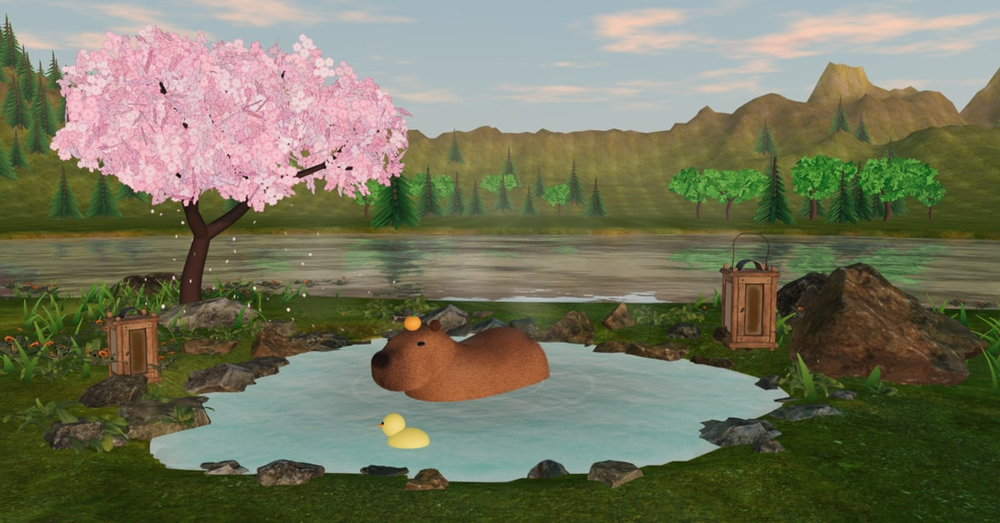

# Capybara Chill

A capybara in a hot spring, **inside an X post**. Lofi radio, sakura petals, a rubber duck, and points that drip in while you keep it company. Hosted on [Sojo](https://sojo.gg).

▶ **Play:** https://capybara.sojo.gg, or tap the card in the [launch post](https://x.com/NukeKevDev/status/2115002602983457219).



## What's inside

- `client/capy.js` is the capybara itself, sculpted in code with no model file. Signed distance fields (ellipsoids and rounded boxes) go through marching cubes into one mesh, then get shell fur: 18 instanced layers with the strand pattern in a shader. The head sits on its own neck pivot, so it can look around, blink, and wiggle when you scratch it.
- `client/scene.js` is the world, built with three.js: a physical sky with drifting shader clouds that follows the viewer's own clock (or a time of day they pick), a reflective lake, a steaming spring, sakura with falling petals, lanterns that light up at sunset, fireflies at night.
- `client/lofi.js` is the radio. Every track is generated live with WebAudio: chords, a swung beat, bells into an echo, vinyl crackle, tape wobble. Nobody's music, so nothing to license.
- `client/main.js` handles the page: Sojo sign-in, farming, the scratch request, the leaderboard, the see-through glass HUD.
- `worker/src.js` is the game server, a Cloudflare Worker plus one Durable Object (SQLite). It runs a fixed rate per minute with a daily pool as a ceiling, one tab per account, and pauses when the capybara goes unscratched.
- `video/record.js` records the promo clip with Playwright and renders the radio offline for the soundtrack.

## Run it

```
npm i
node art/fetch-assets.js       # only if you want to rebuild the assets
npm run dev                    # http://127.0.0.1:8787/?dev=<name>
```

`?dev=<name>` signs you in locally without Sojo (a name with `royal` in it gets Royal). `?t=19.5` forces the hour.

No keys live in this repo. Sojo issues the server key per deploy.

## Credits & licenses

- Rocks, ferns, flowers, lantern, ground texture: [Poly Haven](https://polyhaven.com), CC0.
- Water normals: [three.js](https://github.com/mrdoob/three.js) examples, MIT.
- Fonts: Fredoka and Nunito, SIL Open Font License 1.1 (`static/assets/fonts/OFL-*.txt`).
- Sojo SDK: [@sojogg/sdk](https://www.npmjs.com/package/@sojogg/sdk).

Everything else (the capybara, the scene, the radio, the server) is © NukeKevDev, all rights reserved. You're welcome to read it and learn from it. Please don't republish the game or its art as your own.
